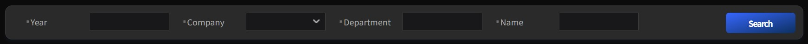

  <a href="../index.md" style="text-decoration:none; font-weight:bold; text-decoration:underline;">Home</a>
  ›
  <strong>Viewtemplates</strong>
  ›
  SearchView

## 📦 NexaLAP_BasePack Manual

### 🔸SearchView
 > 검색 조건 입력 및 조회 화면 구성을 위한 ViewTemplate

 

#### 1. 기능 정의
Layout 기반으로 조회 조건 필드를 배치하고, `fieldWidth`·`labelWidth`로 필드·레이블 크기를 설정하며, `searchbuttontype`에 따라 조회 버튼 위치를 지정하여 **검색 조건 입력 화면**을 효율적으로 구성할 수 있도록 제공되는 ViewTemplate입니다.

 

#### 2.View Property
<table>
  <thead>
    <tr>
      <th style="text-align:center; min-width:100px;">그룹</th>
      <th style="text-align:center; min-width:100px;">Property명</th>
      <th style="text-align:center; min-width:80px;">유형</th>
      <th style="text-align:center; min-width:80px;">값</th>
      <th style="text-align:center; min-width:200px;">설명</th>
    </tr>
  </thead>
  <tbody>
    <tr>
      <td>Basic</td>
      <td>Layout</td>
      <td><code>Layout</code></td>
      <td></td>
      <td>View Layout 설정</td>
    </tr>
    <tr>
      <td>Field</td>
      <td>Field width</td>
      <td><code>String</code></td>
      <td></td>
      <td>Component width 값 설정</td>
    </tr>
    <tr>
      <td>Label</td>
      <td>Label width</td>
      <td><code>String</code></td>
      <td></td>
      <td>Label width 값 설정</td>
    </tr>
    <tr>
      <td>Search Button</td>
      <td>Search button type</td>
      <td><code>Enum</code></td>
      <td>top | middle | bottom</td>
      <td>Search button 위치 설정</td>
    </tr>
  </tbody>
</table>

 

#### 3.Field Property
<table>
  <thead>
    <tr>
      <th style="text-align:center; min-width:100px;">Property명</th>
      <th style="text-align:center; min-width:80px;">유형</th>
      <th style="text-align:center; min-width:80px;">값</th>
      <th style="text-align:center; min-width:200px;">설명</th>
    </tr>
  </thead>
  <tbody>
    <tr>
      <td>Component type</td>
      <td><code>Enum</code></td>
      <td>auto | button | combo | edit | maskedit | textarea | static | radio | checkbox | spin | calendar | imageviewer | multicombo | checkboxset | progressbar | textfield | multilinetextfield | datefield</td>
      <td>Component Type 설정</td>
    </tr>
  </tbody>
</table>