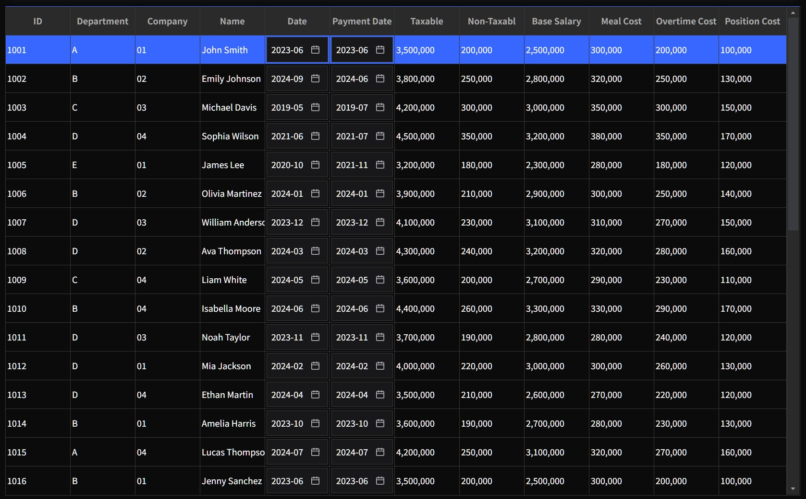

  <a href="../index.md" style="text-decoration:none; font-weight:bold; text-decoration:underline;">Home</a>
  ›
  <strong>Viewtemplates</strong>
  ›
  TreeGridView

## 📦 NexaLAP_BasePack Manual

### 🔸TreeGridView
 > Tree Grid 기반의 계층형 데이터 출력 화면을 구성하기 위한 ViewTemplate

 

#### 1. 기능 정의
Tree Grid 컴포넌트를 기반으로 계층형 데이터를 효율적으로 조회·편집할 수 있는 화면을 구성하기 위해 제공되는 ViewTemplate입니다.

데이터 유형에 따라 Column별 다양한 Component를 적용할 수 있으며, 계층형 데이터 조회 및 편집 기능을 보다 손쉽고 일관된 형태로 구현할 수 있습니다.

 

#### 2. View Property
<table>
  <thead>
    <tr>
      <th style="text-align:center; min-width:100px;">그룹</th>
      <th style="text-align:center; min-width:100px;">Property명</th>
      <th style="text-align:center; min-width:80px;">유형</th>
      <th style="text-align:center; min-width:80px;">값</th>
      <th style="text-align:center; min-width:200px;">설명</th>
    </tr>
  </thead>
  <tbody>
    <tr>
      <td rowspan="5" style="align:center;">Basic</td>
      <td>Layout</td>
      <td><code>GridLayout</code></td>
      <td></td>
      <td>Grid layout 설정</td>
    </tr>
    <tr>
      <td>Autofit</td>
      <td><code>Enum</code></td>
      <td>none | col</td>
      <td>Column 너비 자동 설정 여부</td>
    </tr>
    <tr>
      <td>Tree init status</td>
      <td><code>Enum</code></td>
      <td>"" | collapse,all | collapse,null | expand,all | expand,null</td>
      <td>Cell이 트리 형식일 때 최초 로드 시 표시되는 트리의 상태 설정</td>
    </tr>
    <tr>
      <td>Use tree Checkbox</td>
      <td><code>Boolean</code></td>
      <td>true | false</td>
      <td>Cell이 트리 형식일 때 체크박스 사용 여부 설정</td>
    </tr>
    <tr>
      <td>Use Tree Image</td>
      <td><code>Boolean</code></td>
      <td>true | false</td>
      <td>Cell이 트리 형식일 때 트리 상태를 나타내는 이미지 사용 여부 설정</td>
    </tr>
    <tr>
      <td rowspan="2" style="align:center;">Title</td>
      <td>Use title</td>
      <td><code>Boolean</code></td>
      <td>true | false</td>
      <td>Title 사용 유무 설정</td>
    </tr>
    <tr>
      <td>Title text</td>
      <td><code>String</code></td>
      <td></td>
      <td>Title 값 설정</td>
    </tr>
  </tbody>
</table>

 

#### 3. Field Property
<table>
  <thead>
    <tr>
      <th style="text-align:center; min-width:100px;">Property명</th>
      <th style="text-align:center; min-width:80px;">유형</th>
      <th style="text-align:center; min-width:80px;">값</th>
      <th style="text-align:center; min-width:200px;">설명</th>
    </tr>
  </thead>
  <tbody>
    <tr>
      <td>Display type</td>
      <td><code>Enum</code></td>
      <td>auto | normal | none | buttoncontrol | calendarcontrol | date | checkboxcontrol | combocontrol | combotext | currency | decoratetext | editcontrol | imagecontrol | mask | maskeditcontrol | multicombocontrol | number | progressbarcontrol | text | textareacontrol | treeitemcontrol</td>
      <td>Cell에 표시될 Component 설정</td>
    </tr>
    <tr>
      <td>Edit type</td>
      <td><code>Enum</code></td>
      <td>auto | normal | none | button | checkbox | combo | date | mask | multicombo | readonly | text | textarea | tree</td>
      <td>Cell이 Edit 모드일 때 표시될 Component 설정</td>
    </tr>
  </tbody>
</table>